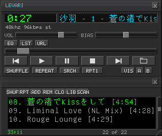

# levari

A tiny, fast Winamp 2.95-style audio player for Linux, Windows and
macOS, written in C11. SDL2 UI with software-rendered skinning,
mp3/ogg/opus/flac/wav/mod/s3m/xm/it/spc (SNES SPC700 rips) decoding
(plus aac/m4a/wma and http/https/icecast network streams via the
optional libav* backend), CJK (JIS X 0208)
text, playlist with editing (sort/reorder/crop/cut-paste/save-as,
`.m3u`/`.m3u8`/`.pls` load), 10-band EQ, spectrum viz, CUE sheets,
drag & drop loading,
daemon + CLI control, MPRIS, media library, and search.

## Build

    cmake -B build -DCMAKE_BUILD_TYPE=Release
    cmake --build build
    sudo cmake --install build --prefix /usr

SDL2 dev headers and a C++ compiler are all it takes on Linux;
[docs/build.md](docs/build.md) covers the optional features (libav*,
MPRIS, MCP), Raspberry Pi tuning, and the Windows and macOS builds.

## Quick start

    levari song.mp3 playlist.m3u album.cue   # start playing
    levari status                            # query the running instance
    levari next                              # control it remotely

## Docs

- [docs/build.md](docs/build.md) — build requirements, optional features, Linux install, Raspberry Pi, Windows cross-build, macOS build
- [docs/ui.md](docs/ui.md) — windows, hotkeys, search, window snapping
- [docs/buttons.md](docs/buttons.md) — what every button in the interface does
- [docs/usage.md](docs/usage.md) — CLI flags, daemon commands, MPRIS, media library
