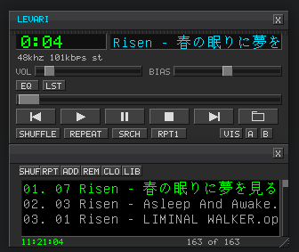

# levari

A tiny, fast Winamp 2.95-style audio player for Linux and Windows,
written in C11.
SDL2 UI with software-rendered skinning, mp3/ogg/opus/flac/wav/mod/s3m/
xm/it decoding (plus aac/m4a/wma via optional libav* backend), CJK
(JIS X 0208) text,
playlist, 10-band EQ, spectrum viz, CUE sheets, daemon + CLI control,
MPRIS, media library, and search.

## Build

    cmake -B build -DCMAKE_BUILD_TYPE=Release
    cmake --build build

Requires: SDL2 dev headers, a C++ compiler (for the vendored libmodplug
module decoder). Everything else is vendored in `third_party/`.
If `libavformat/libavcodec/libavutil` dev packages are present, CMake
enables them automatically for aac/m4a/wma support; without them the
player builds and runs, just without those formats. On Linux, if
`dbus-devel` (pkg-config `dbus-1`) is present, MPRIS support is built
in (desktop media keys, player widgets, `playerctl`); without it the
player runs the same, just off the desktop's radar.

Optional: `-DENABLE_MCP=ON` also builds `levari-mcp`, a stdio MCP
(Model Context Protocol) server for LLM control of the player
(see [docs/usage.md](docs/usage.md)). Off by default, so release
builds don't contain it.

## Linux install

    sudo cmake --install build --prefix /usr

Installs the binary plus `levari.desktop` and the hicolor icon. The
dock/alt-tab icon on GNOME is resolved from the installed desktop file
(matched via `StartupWMClass=levari`), not from the window icon the app
sets at runtime, so it only appears after installing (per-user works
too: copy the desktop file to `~/.local/share/applications/` and the
svg to `~/.local/share/icons/hicolor/scalable/apps/`).

## Windows build

Cross-compile with MinGW-w64 (or build natively in MSYS2). Requires the
SDL2 MinGW devel package from https://libsdl.org (SDL2-devel-mingw.zip)
and a MinGW zlib (static preferred):

    x86_64-w64-mingw32-... # install mingw-w64 gcc/g++ and mingw-zlib
    cmake -B build-win -DCMAKE_TOOLCHAIN_FILE=tools/mingw-w64-toolchain.cmake \
          -DSDL2_DIR=/path/to/SDL2-2.32.10/cmake -DCMAKE_BUILD_TYPE=Release
    cmake --build build-win

Produces a self-contained `levari.exe` (console app; SDL2 and zlib are
linked statically, only system DLLs are required at runtime).
On Windows the player uses the SDL audio backend (WASAPI under the
hood), named pipes (`\\.\pipe\levari-<user>`) for daemon/CLI IPC,
`%APPDATA%\levari` for config and `%LOCALAPPDATA%\levari` for the
library index. Opus playback works if `libopus-0.dll` is next to the
exe; aac/m4a/wma need the libav* DLLs (not supported in the Windows
build yet).

## Quick start

    levari song.mp3 playlist.m3u album.cue   # start playing
    levari status                            # query the running instance
    levari next                              # control it remotely

## Docs

- [docs/ui.md](docs/ui.md) — windows, hotkeys, search, window snapping
- [docs/buttons.md](docs/buttons.md) — what every button in the interface does
- [docs/usage.md](docs/usage.md) — CLI flags, daemon commands, MPRIS, media library
